  

### Hi, I'm Jerod 👋

Director of Tech Evangelism at [CData](https://www.cdata.com) (been there since 2013). I run [**CData Labs**](https://www.cdata.com/labs/): we test how the data layer behind an AI agent changes accuracy, tokens and cost, then publish everything so you can check our math.

Off the clock: Transformers (yes, the handle), Marvel, Warhammer and board games. Former host of the [BattleMallet Podcast](https://www.battle-mallet.com).

#### 🔬 Recent research

| Finding | Paper |
| --- | --- |
| **93%** fewer tokens, same answers | [MCP gateway cost study](https://www.cdata.com/lp/mcp-gateway-cost-whitepaper/) · Oct 2026 |
| **178x** cost spread at equal accuracy | [AI cost study](https://www.cdata.com/lp/ai-cost-whitepaper/) · Sep 2026 |
| **98.5%** accuracy vs. 65 to 75% | [MCP architecture study](https://www.cdata.com/lp/ai-accuracy-whitepaper/) · Mar 2026 |

🧪 <b>Open benchmarks</b>: fork them, break them, tell me what you find

- [connect-ai-model-benchmark](https://github.com/CDataSoftware/connect-ai-model-benchmark): accuracy and cost across 40+ models
- [connect-ai-gateway-benchmark](https://github.com/CDataSoftware/connect-ai-gateway-benchmark): effort per correct answer by MCP gateway
- [connect-ai-context-benchmark](https://github.com/CDataSoftware/connect-ai-context-benchmark): what business context does for answers
- [connect-ai-token-benchmark](https://github.com/CDataSoftware/connect-ai-token-benchmark): token efficiency of the data layer
- [connect-ai-accuracy-test-harness](https://github.com/CDataSoftware/connect-ai-accuracy-test-harness): accuracy by MCP server architecture

#### 🎤 Talks & 🛠️ side projects

- 🎤 [AI Gateway: Route, Govern, and Learn From Every Agent Interaction](https://events.linuxfoundation.org/archive/2026/agntcon-mcpcon-north-america/program/demo-theater/#ai-gateway-route-govern-and-learn-from-every-agent-interaction-with-fabric) · MCPCon NA 2026
- 🎤 [CData Labs: Testing the Gateway in the Open](https://www.cdata.com/events/foundations-2026/) · CData Foundations 2026
- 🕹️ [connect-ai-maze-runner](https://github.com/jeRodimusPrime/connect-ai-maze-runner): a maze game where every dot is data a model reads
- 🧩 [connect-ai-claude-skill](https://github.com/jeRodimusPrime/connect-ai-claude-skill): a Claude skill for enterprise data via Connect AI

#### 👾 Every dot is a day of commits

<picture>
  <source media="(prefers-color-scheme: dark)" srcset="https://raw.githubusercontent.com/jeRodimusPrime/jeRodimusPrime/output/pacman-contribution-graph-dark.svg">
  <source media="(prefers-color-scheme: light)" srcset="https://raw.githubusercontent.com/jeRodimusPrime/jeRodimusPrime/output/pacman-contribution-graph.svg">
  
</picture>

#### 📫 Find me

[![LinkedIn](https://img.shields.io/badge/Jerod_Johnson-0A66C2?style=for-the-badge&logo=data%3Aimage%2Fpng%3Bbase64%2CiVBORw0KGgoAAAANSUhEUgAAADAAAAAwCAYAAABXAvmHAAAEH0lEQVR42u2ay4sdVRDGf1%2Ffnokyany7CAaEAV9gYDbiSpBgQjYBEURFFMegoCC48w%2FwsRWyUlTwtVUXbhQUshIFA4qoILgQBSUOmCAT597uz00dOXa6723nZmZ6YA40PXNOnb71OlVfVTe2ZVvsgmF71JxTtngIuL45v9M8By9j4FtJv9suJNW5VFfa%2FsDDH3%2FYfjx4Lv61gO13gYeAuiH5UIaCn%2BQ%2BK5JOJ0uUwH1ABRQDcp22MQYWgOPA6eC3LkOy0Qw%2FTBYpBmCJS%2FLJWQxVsbGIyw1X2ykheglQZ5b5EfgpE6Yeil8VU5gvgI%2BBFeA24Fbg7tz%2FhiBA2eE2BfAFcExSla2dsn0Y%2BAo4mAk6OAsIeEFSZXsxyxn7JK0BrwRNPTQXSvHWwHcBMSbZ%2BiTmvh5AVGplIGlVwFVxV2NdwDXZWRncIU5MrQbmkO3S9gJQxdzqUDBT0XGwa%2BCE7aclTeIaA4XtF4F7G2F2UFGILGmdtP0wcCrS%2BGHgjjmjT57ZNa8lyxk%2FNAbuiiuNjRCmGXrdEc1GLVm9yfAky%2FYXTYACWGyZb5vrg6USzTngTFjx8qhBykzI0bwCJPf4EngzHlg3otRzwHJorgTeAj7PaBPdIeDJ%2BP8j4LVIkGdCqCXgRuAe4KnI9v9PCNsbjcJhHPc3puz5NGjOx%2F3%2BDrqjtmvbj%2FTg41Lbr8fzqpaCJvH1UtCXs1xoXxCVWTJLGKh5Bq5o0I5Ck9cBz0h6O9bb0KyAQtI6sGr7AHCkryWmHmJJE9tImqRSTlJtu3lgq5zWdiXJtj%2BUdDaK8TpHs5KcnZE6o3k2Mv3CPFhoPtAezAXzCmXUkqq4nNe1QVuFJX6IsK2wwvYLkPm1JDmsdrPt47aP2b425prhNLV4Pulbm5dbXUGFpk8CJzKf%2Fs32g5I%2Bsz3KILvDOt%2F0TXDFFmq%2FDNz0RITI5BJj4Abg1YDquSWSxn%2FtkV%2B23IVStHksGE%2FYaSH%2BXgZuj%2FPS1PS5LPJ52wUI369tLwE3tXQ%2BUnY%2B2MHHuM8B3o6C5LLItl0tw6WtKikvZhtEM9YHLcCOFfV7AuwJsCfALuDdtsrdyr2kjVlgTqlIyeB%2FYbtuid9Fg1ZRM4x6aDHfl54%2FbV8de1aAtWkC%2FB2FzKQFKoyb2KWN1vbaDCwzbV%2FXmERn8E7gbDklO95i%2B9GsPExrBg400OKRwD2jrH1iYH9HZZV%2B46jt%2FS37rp5iBQHngZ%2BBP2V7o2%2F5tsMjdUBelvR8KGx9VmOrCxGOGuegpr3Rq1n%2BvIl9ySXX01vKaUCrb5TaVFdtE%2Fuc0RdAXYRpKob1brjLWgL%2Bamrgvcxc9YCvxVDy%2B%2F%2Bp%2BGwv2X7H9mTgnxr8YvuB1J%2B6oKCwvRzF9tDe1qcu%2BffRZ7rgYw81m0xDHW2f2%2FwDR8On9Vp3Ad0AAAAASUVORK5CYII%3D)](https://www.linkedin.com/in/jerod-johnson/)

📍 Apex, NC
